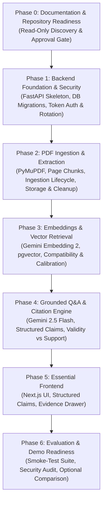

# ProofLens AI — Implementation Plan

**Document Identifier:** PLAI-PLAN-001  
**Version:** 1.3 — Execution Baseline (Controlled Revision)  
**Status:** Under Review (Phase 0 Approval Gate)  
**Estimated Timeline:** 2–3 Days (Planning Constraint for Prototype Delivery, Not Guaranteed SLA)  
**Execution Guardrail:** This document defines the exact execution roadmap. Implementation must not commence until Phase 0 review and approval are formally recorded.

---

## 1. Plan Structure and Execution Principles

This implementation plan translates the system design in [`docs/TECHNICAL-DESIGN.md`](./TECHNICAL-DESIGN.md) into seven strictly ordered, dependency-aware phases. Each phase is self-contained with explicit prerequisites, tasks in execution sequence, expected files, automated verification tests, risks, and an observable Definition of Done (DoD).

### Critical-Path Dependency Graph



### Scope Control & Time-Boxing (2–3 Day Delivery Track)
The prototype timeline of 2–3 days is treated as a **planning constraint**, not an absolute completion guarantee. To ensure a solid, working system without taking architectural shortcuts, features are categorized into four strict priority tiers:

1.  **Tier 1: Core Demonstrable Vertical Slice (Days 1–2):**
    *   Backend-first foundation: PostgreSQL 16 + pgvector async setup, composite foreign key referential integrity, capability token generation, salted SHA-256 storage, and atomic token rotation.
    *   PDF upload, file signature validation, and private file storage.
    *   Page-aware text extraction using PyMuPDF preserving 1-based physical page numbers.
    *   Sentence-snapped chunking strictly within page boundaries.
    *   Batch vector embeddings via Google Gemini Embedding 2 (`gemini-embedding-2`, 768 dimensions; provisional) stored in PostgreSQL 16 with pgvector.
    *   Strict embedding compatibility enforcement (matching canonical provider, model, version, dimension tuple with complementary indexing and query task roles).
    *   Workspace-scoped semantic retrieval with cosine distance scoring and calibrated thresholding.
    *   Grounded Q&A via Google Gemini 2.5 Flash (`gemini-2.5-flash`; provisional) with structured claim decomposition and answer construction contract prohibiting unverified assertions.
    *   Server-side deterministic citation validation (separating structural validity from machine-assisted claim support).
    *   Explicit abstention when evidence is insufficient or relevance is below threshold.
    *   Responsive Next.js web interface (implemented in Phase 5): Document upload dropzone, processing status polling, Q&A interface with interactive citation chips, claim status indicators, and slide-over evidence inspection drawer.
2.  **Tier 2: Required Operational Reliability (Day 2):**
    *   Scanned/image-only PDF heuristic detection and clear user error reporting.
    *   FastAPI canonical background ingestion lifecycle (`PENDING` $\rightarrow$ `EXTRACTING` $\rightarrow$ `CHUNKING` $\rightarrow$ `EMBEDDING` $\rightarrow$ `COMPLETED` / `FAILED`).
    *   Phase-specific startup recovery for stale in-progress jobs (transitioning interrupted `PENDING`, `EXTRACTING`, `CHUNKING`, `EMBEDDING` records to `FAILED` without claiming automatic in-process resumption).
    *   Durable, recoverable deletion workflow (startup sweeper for pending `DELETING` records with retry limits, plus storage orphan file audit with a 2-hour safety grace period).
    *   Bounded API retries with jitter for external AI rate limits (HTTP 429).
3.  **Tier 3: Priority Optional Enhancements (Day 3, Time-Permitting):**
    *   Cross-document comparison interface with normalized junction table persistence and per-document cited claims.
    *   Document ingestion manual retry endpoint (`POST /documents/{id}/retry`) — core lifecycle failure states and automatic startup recovery are mandatory; manual retry is an optional convenience.
    *   Evaluation summary dashboard view in Next.js.
4.  **Tier 4: Out of Scope for MVP (Post-Demo Scope):**
    *   User accounts, multi-tenant RBAC, OAuth2 / SSO.
    *   Optical Character Recognition (OCR) for scanned PDFs.
    *   Hybrid BM25 keyword search with Reciprocal Rank Fusion (unless evaluation proves dense retrieval misses).
    *   Durable distributed task queues (Celery/Redis).
    *   Autonomous multi-agent orchestration (LangGraph, CrewAI).

---

## 2. Phased Implementation Roadmap

---

### Phase 0 — Documentation and Repository Readiness
*   **Objective:** Conduct read-only repository inspection, confirm workspace baseline and root path, review product requirements in `ProofLens-AI-Project-Kickoff-PRD-v0.1.md`, finalize technical architecture, resolve inconsistencies, and obtain approval before implementation.
*   **Scope:**
    *   Inspect confirmed project root `e:\ProofLense`.
    *   Verify repository state: confirmed that Git is not yet initialized and no application files, package manifests, or database migrations exist.
    *   Confirm presence of existing target documentation files: `docs/TECHNICAL-DESIGN.md` and `docs/IMPLEMENTATION-PLAN.md`.
    *   Verify external model availability via official documentation (`gemini-embedding-2`: provisional, `text-embedding-004`: shut down on Jan 14, 2026, `gemini-2.5-flash`: provisional).
    *   Harmonize both documents around workspace security (salted hashed tokens, atomic rotation), database referential integrity (composite foreign keys), citation validity vs machine-assisted claim support, canonical ingestion lifecycle, durable deletion reconciliation, and calibrated evaluation.
*   **Explicit Exclusions:**
    *   No application code, configuration files, or database migrations.
    *   No Git initialization, commits, or branch changes.
    *   No dependency installations.
*   **Dependencies & Prerequisites:** PRD document (`ProofLens-AI-Project-Kickoff-PRD-v0.1.md`).
*   **Tasks in Execution Order:**
    1.  *Task 0.1:* Inspect workspace root (`e:\ProofLense`) and verify no application files exist.
    2.  *Task 0.2:* Re-read PRD and audit requirements against proposed architecture.
    3.  *Task 0.3:* Revise `docs/TECHNICAL-DESIGN.md` addressing model availability, canonical embedding compatibility tuple with complementary task roles, workspace capability-token security, structured claim contract prohibiting unverified assertions, phase-specific startup recovery for all in-progress states, two-part deletion and orphan file recovery, and calibrated evaluation metrics.
    4.  *Task 0.4:* Revise `docs/IMPLEMENTATION-PLAN.md` adopting a backend-first Phase 1, aligning Phase 2 and Phase 3 ingestion lifecycles and recovery hooks, and ensuring exact matching of schemas and endpoints.
    5.  *Task 0.5:* Submit revised documentation for user review and approval gate.
*   **Expected Files:**
    *   `docs/TECHNICAL-DESIGN.md` (Updated)
    *   `docs/IMPLEMENTATION-PLAN.md` (Updated)
*   **Acceptance Criteria:**
    *   Both documents exist at exact paths and contain all mandatory sections.
    *   Traceability matrix maps 100% of PRD functional requirements (FR-01 to FR-09).
    *   Decision register clearly labels confirmed, provisional, and unverified items.
    *   Database tables, composite constraints, API schemas, and document states match identically between both documents.
*   **Verification Commands:**
    ```bash
    Test-Path docs/TECHNICAL-DESIGN.md
    Test-Path docs/IMPLEMENTATION-PLAN.md
    ```
*   **Risks & Failure Conditions:** Premature coding without approval; unverified external provider assumptions.
*   **Definition of Done (DoD):** Both documentation files revised and cross-verified; user provides explicit confirmation to proceed to Phase 1.

---

### Phase 1 — Backend Foundation & Workspace Security
*   **Status:** **COMPLETED & FROZEN** (Verified on Supabase PostgreSQL + pgvector + Supabase Cloud Storage)
*   **Objective:** Scaffold the backend (FastAPI) project skeleton, establish async database connection with Supabase PostgreSQL (pgvector) as official primary database, apply initial Alembic migrations with composite foreign keys and concurrency lease columns (`processing_heartbeat`, `worker_id`), implement capability-token workspace security with atomic token rotation, enforce static environment and credential validation (without live external network probes), and build health probes.
*   **Backend-First Implementation Strategy:**
    *   Phase 1 focuses **exclusively on the backend foundation**.
    *   Next.js scaffolding and frontend implementation are **deferred to Phase 5** until the core backend workflow, RAG pipeline, and API contracts are fully verified with automated tests.
    *   *Model Verification Scope (Fix 5):* Phase 1 performs **static configuration and credential presence checks only** (confirming required environment variables and non-empty key strings without printing secret values). **No external network calls, provider probes, or quota tests are executed in Phase 1.** Live embedding probes are scheduled in Phase 3, and live LLM generation probes in Phase 4.
*   **Scope:**
    *   FastAPI application structure with Pydantic v2 settings.
    *   Static configuration validation: `DATABASE_URL`, `GEMINI_API_KEY`, `EMBEDDING_MODEL`, `LLM_MODEL`. Verifying non-empty credential strings without leaking secrets.
    *   Async SQLAlchemy 2.0 connection to Supabase PostgreSQL via `asyncpg` (with pooler statement cache disabled) and `pgvector` extension verification.
    *   Alembic migration scripts creating initial database schema:
        *   `workspaces` (with `token_hash` and `token_salt`)
        *   `documents` (with composite unique constraint on `(id, workspace_id)`, `deletion_attempts`, `deletion_error`, `processing_heartbeat`, `worker_id`, `is_corpus_excluded`, `corpus_exclusion_reason`, and `corpus_excluded_at`)
        *   `document_pages` (with composite unique constraints on `(id, document_id)` and `(document_id, page_number)`)
        *   `document_chunks` (with composite FKs referencing `documents(id, workspace_id)` and `document_pages(id, document_id)`, embedding metadata columns including canonical 5-tuple fingerprint `(embedding_provider, embedding_model, embedding_version, embedding_dimensions, task_type)` with `task_type VARCHAR(32) NOT NULL DEFAULT 'RETRIEVAL_DOCUMENT'`, plus pgvector HNSW index)
        *   `conversations` and `messages` (with canonical validated claims schema in `messages.claims`)
        *   `comparisons` and normalized junction table `comparison_documents` (with composite FKs)
    *   Workspace capability token generation (`secrets.token_urlsafe(32)`), salted SHA-256 hashing, and constant-time token verification dependency (`hmac.compare_digest`).
    *   Atomic token rotation endpoint (`POST /api/v1/workspaces/{id}/tokens/rotate`) with workspace mismatch rejection and immediate old token invalidation.
    *   Liveness (`/health/live`) and readiness (`/health/ready`) endpoints.
    *   Pytest test harness with `conftest.py`.
    *   Storage abstraction (`StorageService`): `SupabaseStorageService` (private bucket `prooflens-documents`, signed URLs, atomic SHA-256 uploads) and `LocalStorageService` (path traversal protection, offline dev/test fallback).
*   **Explicit Exclusions:** Document parsing, live vector embedding API calls, external LLM network calls, and Next.js / frontend UI scaffolding (deferred to Phase 5).
*   **Dependencies & Prerequisites:** Phase 0 approval; Supabase PostgreSQL 16 project with pgvector (or local PostgreSQL development instance).
*   **Tasks in Execution Order:**
    1.  *Task 1.1:* Initialize Python virtual environment and configure backend dependencies in `backend/requirements.txt` (`fastapi`, `uvicorn`, `sqlalchemy[asyncio]`, `asyncpg`, `pgvector`, `alembic`, `pydantic-settings`, `pymupdf`, `google-genai`, `tenacity`, `pytest`, `httpx`).
    2.  *Task 1.2:* Build core configuration module (`backend/app/core/config.py`) loading and validating environment variables (`DATABASE_URL`, `GEMINI_API_KEY`, `EMBEDDING_MODEL`, `LLM_MODEL`, `STORAGE_BACKEND`, `RETRIEVAL_SIMILARITY_THRESHOLD`). Verify credential presence (non-empty string check; logging format: `GEMINI_API_KEY: SET (len=39)`). Ensure zero live network calls occur during config initialization.
    3.  *Task 1.3:* Implement security module (`backend/app/core/security.py`) for capability token generation, salted SHA-256 hashing, `hmac.compare_digest` verification, and atomic rotation.
    4.  *Task 1.4:* Implement async database engine and session factory (`backend/app/db/session.py`) and declarative Base (`backend/app/db/base.py`).
    5.  *Task 1.5:* Implement SQLAlchemy ORM models (`workspaces`, `documents`, `document_pages`, `document_chunks`, `conversations`, `messages`, `comparisons`, `comparison_documents`) with composite foreign keys, concurrency lease columns (`processing_heartbeat`, `worker_id`), document exclusion audit columns (`is_corpus_excluded`, `corpus_exclusion_reason`, `corpus_excluded_at`), and embedding metadata columns (including canonical 5-tuple fingerprint and `task_type VARCHAR(32) NOT NULL DEFAULT 'RETRIEVAL_DOCUMENT'`).
    6.  *Task 1.6:* Configure Alembic (`alembic.ini`, `alembic/env.py`) and author initial migration creating tables, composite constraints, concurrency lease columns, document exclusion audit columns, and the pgvector HNSW index (`vector_cosine_ops`).
    7.  *Task 1.7:* Implement workspace creation endpoint (`POST /api/v1/workspaces`) returning raw token once, and token rotation endpoint (`POST /api/v1/workspaces/{id}/tokens/rotate`).
    8.  *Task 1.8:* Implement health check routes (`backend/app/api/v1/health.py`) and global error handler middleware.
    9.  *Task 1.9:* Implement storage services: `SupabaseStorageService` (`backend/app/storage/supabase.py`) and `LocalStorageService` (`backend/app/storage/local.py`).
    10. *Task 1.10:* Set up pytest testing framework (`backend/tests/conftest.py`) and write tests covering configuration validation, database URL normalization, health probes, token authentication and isolation, storage CRUD and traversal prevention.
*   **Expected Files Implemented:**
    *   `backend/requirements.txt`, `backend/alembic.ini`
    *   `backend/app/main.py`, `backend/app/core/config.py`, `backend/app/core/database.py`, `backend/app/core/database_url.py`, `backend/app/core/db_inspector.py`
    *   `backend/app/models/*.py`, `backend/alembic/versions/001_initial_schema.py`
    *   `backend/app/api/v1/health.py`, `backend/app/api/v1/workspaces.py`, `backend/app/api/deps.py`
    *   `backend/app/storage/base.py`, `backend/app/storage/local.py`, `backend/app/storage/supabase.py`
    *   `backend/tests/test_database_config.py`, `backend/tests/test_embedding_provider.py`, `backend/tests/test_health.py`, `backend/tests/test_storage.py`, `backend/tests/test_workspaces.py`
*   **Acceptance Criteria:**
    *   Backend starts cleanly via `uvicorn backend.app.main:app` without attempting external Gemini API calls.
    *   Static configuration validation confirms `GEMINI_API_KEY` presence without logging secret values.
    *   `GET /api/v1/health` returns HTTP 200 with database provider (`supabase`), storage type (`supabase`), and canonical embedding 5-tuple.
    *   Alembic migration runs successfully (`alembic upgrade head`) creating tables with composite FKs and lease columns (`processing_heartbeat`, `worker_id`).
    *   Creating a workspace returns raw token; database stores only salted hash.
    *   Requesting workspace without valid token returns `401 Unauthorized`.
    *   Client-supplied workspace ID in path cannot override token authorization scope (mismatched tokens return `401 Unauthorized`).
    *   Token rotation immediately invalidates the old token; subsequent requests presenting old token return `401 Unauthorized`.
    *   Raw capability tokens and API keys never appear in application logs or error response bodies.
*   **Verification Record (Phase 1 Freeze Checkpoint):**
    *   **Automated Tests:** 29 / 29 passed (`pytest -v`, 29.60s execution time, 100% pass rate).
    *   **Database:** Supabase PostgreSQL 17.11 connected via Session Pooler (`aws-0-ap-southeast-1.pooler.supabase.com:5432`); `pgvector` extension installed; 9 canonical tables created.
    *   **Storage:** Supabase Storage private bucket `prooflens-documents` verified with `SupabaseStorageService` (CRUD and signed URLs operational).
    *   **Alembic Revision:** `001_initial_schema` (`ALREADY_MIGRATED`).
*   **Definition of Done (DoD):** Backend foundation, workspace security, Supabase database, pgvector, Supabase Storage, and health probes 100% verified with automated tests. Phase 1 is frozen and ready for Phase 2.

---

### Phase 2 — PDF Ingestion
*   **Status:** **COMPLETE & VERIFIED (62/62 Automated Tests Passing)**
*   **Objective:** Implement secure PDF upload, private file storage, page-aware text extraction using PyMuPDF, sentence-snapped chunking within page boundaries, document processing state tracking with database concurrency leases (`worker_id`, `processing_heartbeat`), safe startup recovery protecting active jobs, idempotent retries, provider-aware durable deletion, and orphan reconciliation.
*   **Canonical Ingestion Lifecycle Alignment:**
    *   The canonical state machine is: $\text{PENDING} \rightarrow \text{EXTRACTING} \rightarrow \text{CHUNKING} \rightarrow \text{READY}$ (Phase 2), with Phase 3 extending to $\text{EMBEDDING} \rightarrow \text{COMPLETED}$.
    *   In Phase 2, the pipeline executes extraction and chunking: $\text{PENDING} \rightarrow \text{EXTRACTING} \rightarrow \text{CHUNKING} \rightarrow \text{READY}$.
    *   **Crucial Invariant:** Vector embeddings are NOT populated during Phase 2 (768-dim `embedding` column remains `NULL`). Phase 3 will generate Gemini embeddings and transition documents to `COMPLETED`.
*   **Scope & Implemented Features:**
    *   File validation: MIME type (`application/pdf`), size ($\le 50$ MB), magic bytes (`%PDF-`), PyMuPDF parseability, unencrypted checks, and duplicate SHA-256 hash detection per workspace (`409 Conflict`).
    *   Storage abstraction (`StorageService`): Active Supabase Storage (`prooflens-documents`) with explicit `LocalStorageService` dev/test fallback.
    *   PyMuPDF extraction engine (`PDFExtractor`): Page-by-page text extraction, 1-based physical page numbering, line ending normalization, and scanned PDF heuristic detection (`SCANNED_PDF_UNSUPPORTED`).
    *   Sentence-aware text chunker (`TextChunker`): Sentence boundary snapping, configurable target (1000 chars) and max (1500 chars) lengths, sentence overlap (200 chars), long sentence subdivision, character offset tracking (`char_start`, `char_end`), stable chunk index ordering, and empty page handling.
    *   Document Service (`DocumentService`): Atomic file upload, DB registration with compensating storage cleanup, page persistence, chunk persistence without fake embeddings, document listing with pagination, and status retrieval.
    *   Durable Deletion (`DocumentService.delete_document`): Idempotent deletion, `DELETING` status marker, storage object removal with retry tracking (`deletion_attempts`, `deletion_error`), database cascade deletion of pages and chunks, and historical citation marking (`document_deleted: true`).
    *   Interrupted-Job Recovery & Retries (`RecoveryService`): Automated recovery sweeper detecting crashed/orphaned jobs exceeding the 15-minute lease grace period (`INGESTION_LEASE_TIMEOUT_SECONDS = 900`), scalar-attribute loading avoiding async greenlet errors, and bounded retry policy.
    *   REST APIs (`backend/app/api/v1/documents.py`):
        *   `POST /api/v1/documents`
        *   `GET /api/v1/documents`
        *   `GET /api/v1/documents/{document_id}`
        *   `DELETE /api/v1/documents/{document_id}`
        *   `POST /api/v1/documents/{document_id}/retry`
        *   `POST /api/v1/documents/recovery/stale-jobs`
*   **Implemented Deliverables:**
    *   `backend/app/services/pdf_extractor.py` (PyMuPDF deterministic extractor)
    *   `backend/app/services/text_chunker.py` (Sentence-aware text chunker)
    *   `backend/app/services/document_service.py` (Ingestion, listing, status, durable deletion)
    *   `backend/app/services/recovery_service.py` (Interrupted-job recovery sweeper)
    *   `backend/app/schemas/document.py` (Pydantic models for upload, list, detail, delete, recovery)
    *   `backend/app/api/v1/documents.py` (Document endpoints with workspace token auth)
    *   `backend/tests/test_pdf_extractor.py` (9 unit tests)
    *   `backend/tests/test_text_chunker.py` (7 unit tests)
    *   `backend/tests/test_document_ingestion.py` (10 integration tests)
    *   `backend/tests/test_document_deletion.py` (3 integration tests)
    *   `backend/tests/test_document_recovery.py` (4 integration tests)
*   **Verification Evidence & Actual Test Results:**
    ```powershell
    $env:PYTHONPATH="e:\ProofLense"; ..\.venv\Scripts\pytest.exe -v
    ```
    *Result:* **66 passed in 154.02s** (29 Phase 1 regression tests + 37 Phase 2 tests, 0 failures, 0 skipped).
*   **Definition of Done (DoD):** Document upload, PyMuPDF extraction, sentence-aware chunking, status transitions, durable deletion with citation marking, heartbeat lease recovery, and workspace tenant isolation 100% verified with passing automated tests. Phase 2 is complete.

---

### Phase 3 — Embeddings and Vector Retrieval
*   **Objective:** Execute live embedding API probe and quota verification for Google Gemini Embedding 2 (`gemini-embedding-2`), generate 768-dimensional embeddings for chunks with canonical metadata 5-tuple tracking, persist vectors to pgvector, complete the ingestion lifecycle to `COMPLETED`, extend lease-based startup recovery to `EMBEDDING` jobs, enforce complementary task roles (`RETRIEVAL_DOCUMENT` vs `RETRIEVAL_QUERY`), implement the fail-closed `CorpusCompatibilityGate` to reject incomplete, failed, or incompatible corpora (`HTTP 409 Conflict` / `HTTP 503 Service Unavailable`), implement workspace-isolated semantic search, and calibrate the retrieval similarity threshold.
*   **Live Model Verification Scope (Fix 5):**
    *   Phase 3 is the **authoritative phase for live embedding provider verification**.
    *   Executes a lightweight live network probe via `client.models.embed_content` on a test string (`"ProofLens AI embedding probe"`), confirming 768-dimensional vector generation, API key quota availability, and latency.
    *   Sanitizes all error outputs on rate limit (HTTP 429) or quota exhaustion without exposing credentials.
*   **Scope:**
    *   Live API key access and quota verification for `gemini-embedding-2`.
    *   Embedding client wrapper using `google-genai` SDK with `task_type="RETRIEVAL_DOCUMENT"` and `output_dimensionality=768`.
    *   Persist canonical embedding compatibility metadata 5-tuple fingerprint on every chunk: `embedding_provider`, `embedding_model`, `embedding_version`, `embedding_dimensions`, and `task_type`.
    *   Complete ingestion pipeline transition: `CHUNKING → EMBEDDING → COMPLETED`.
    *   Extend lifespan startup recovery hook to sweep documents left in `EMBEDDING` without an active heartbeat ($> 15$ min) and transition them to `FAILED` with explicit diagnostics.
    *   Batch embedding generation during ingestion (up to 32 chunks per call) with bounded exponential retries and jitter.
    *   pgvector similarity search repository querying `embedding <=> query_vector` filtered strictly by `workspace_id` and `status = 'COMPLETED'`.
    *   **The Corpus Compatibility Gate (`CorpusCompatibilityGate`) (Fix 2):**
        *   Evaluates active workspace corpus compatibility before executing similarity search.
        *   Operates under a strict **Fail-Closed Policy**: never marks a corpus compatible based only on the subset of successfully completed documents. Any failed check, ineligible document state, or internal DB error blocks retrieval immediately.
        *   *Preconditions:* Responsive DB connection, valid workspace capability token, and active configuration 5-tuple in application settings (`ACTIVE_EMBEDDING_CONFIG`).
        *   *Required Corpus Definition & Intentional Exclusions:*
            *   All documents with `is_corpus_excluded == FALSE` constitute the strictly required corpus ($D_{\text{required}}$).
            *   Intentional exclusions must be explicitly audited via `is_corpus_excluded = TRUE`, `corpus_exclusion_reason`, and `corpus_excluded_at`.
        *   *The Exact 6-Step Verification Pipeline:*
            1.  **Population Check:** If total required document count is 0, evaluate `ENABLED` (empty workspace; retrieval short-circuits to `[]`).
            2.  **Ineligible Lifecycle States Check:** Query documents in `status IN ('PENDING', 'EXTRACTING', 'CHUNKING', 'EMBEDDING', 'DELETING')`. If count $> 0$, evaluate `BLOCKED` (`HTTP 409 Conflict`) reporting all in-flight documents in `gate_report.in_flight_documents`.
            3.  **Explicit FAILED Document Detection (Zero Silent Exclusion):** Query documents in `status = 'FAILED'` within the required corpus. If count $> 0$, evaluate `BLOCKED` (`HTTP 409 Conflict`) reporting exact document IDs, filenames, and diagnostic errors in `gate_report.failed_documents`. Failed documents are **never** silently excluded.
            4.  **Expected vs Completed Parity Check:** Verify $total\_required == total\_completed$. If count differs, evaluate `BLOCKED` (`HTTP 409 Conflict`) to detect missing documents or interrupted batches.
            5.  **Chunk Population & Null Vector Verification:** Verify every completed document has chunk count $> 0$ and zero NULL embeddings. If violated, evaluate `BLOCKED` (`HTTP 409 Conflict`).
            6.  **Uniform 5-Tuple Fingerprint & Task Role Match:** Inspect distinct `(embedding_provider, embedding_model, embedding_version, embedding_dimensions, task_type)` across all chunks of completed required documents. If distinct count $> 1$, if tuple does not match active config with `task_type = 'RETRIEVAL_DOCUMENT'`, or if any metadata column is NULL, evaluate `BLOCKED` (`HTTP 409 Conflict`).
        *   *Fail-Closed Invariant:* Any database connection failure, query error, or timeout immediately fails closed with `HTTP 503 Service Unavailable`, never failing open.
        *   *Structured Conflict Envelope:* Returns structured `gate_report` containing `gate_state: "BLOCKED"`, document counts, `in_flight_documents`, `failed_documents`, `mismatched_documents`, and `active_config`.
    *   **Atomic Re-Embedding Lifecycle & Crash Recovery:**
        *   Old chunks are retained while a document is in progress; they are swapped with new chunks in a single atomic SQL transaction (`DELETE old + INSERT new + UPDATE status = 'COMPLETED'`) only after new embeddings are generated.
        *   Mid-process worker crashes roll back the transaction, leaving no partial chunks.
        *   `CorpusCompatibilityGate` remains `BLOCKED` throughout re-embedding until 100% of required documents complete under the active configuration.
        *   Incomplete or failed re-embedding batches cannot be reported as compatible. Subsequent retries via `POST /documents/{id}/retry` reprocess failed documents; once all required documents pass all 6 checks, the gate transitions to `ENABLED`.
    *   Enforce complementary asymmetric task roles (`RETRIEVAL_DOCUMENT` for stored chunks, `RETRIEVAL_QUERY` for user queries).
    *   Configurable relevance threshold (`RETRIEVAL_SIMILARITY_THRESHOLD`, default `0.65`) with calibration against domain test queries.
    *   Semantic search endpoint (`POST /api/v1/workspaces/{id}/retrieval/search`) returning chunks, page numbers, similarity scores, and stable chunk UUIDs.
    *   Retrieval evaluation test measuring Recall@5 on sample queries.
*   **Explicit Exclusions:** LLM answer synthesis and citation verification (deferred to Phase 4).
*   **Dependencies & Prerequisites:** Phase 2 chunking pipeline; valid `GEMINI_API_KEY`.
*   **Tasks in Execution Order:**
    1.  *Task 3.1:* Validate live API access and quota for `gemini-embedding-2` using a lightweight live probe (`client.models.embed_content`).
    2.  *Task 3.2:* Build Gemini embedding client wrapper (`backend/app/services/embedding_service.py`) supporting batching, retry with jitter, dimension validation (768), and canonical metadata tagging (`google`, `gemini-embedding-2`, `v1`, 768, `RETRIEVAL_DOCUMENT`).
    3.  *Task 3.3:* Connect chunk embedding step into background document ingestion pipeline (`document_service.py` transitions to `EMBEDDING` and then `COMPLETED` **only after** vector persistence succeeds); implement atomic chunk swap transaction for re-embedding; extend lifespan startup recovery hook to detect stale `EMBEDDING` records (> 15 min heartbeat) and mark them `FAILED`.
    4.  *Task 3.4:* Implement chunk repository (`backend/app/repositories/chunk_repo.py`) executing pgvector cosine distance queries (`<=>`) with workspace filtering and `COMPLETED` status enforcement.
    5.  *Task 3.5:* Build retrieval domain service (`backend/app/services/retrieval_service.py`) and `CorpusCompatibilityGate`:
        *   Generate user query embeddings with `task_type="RETRIEVAL_QUERY"`, matching active model and 768 dimensions.
        *   Implement the exact 6-step fail-closed verification pipeline before executing vector search.
        *   Check for documents in non-terminal states (`PENDING`, `EXTRACTING`, `CHUNKING`, `EMBEDDING`, `DELETING`) and block search.
        *   Explicitly detect `FAILED` documents in required corpus, report their document IDs and failure statuses, and prevent silent exclusion.
        *   Enforce 100% parity between required and completed document sets, chunk count $> 0$, and zero NULL vectors.
        *   Verify uniform 5-tuple fingerprint match across 100% of chunks against `ACTIVE_EMBEDDING_CONFIG`.
        *   Fail closed with `HTTP 503` on any database query failure or timeout.
        *   Return structured `HTTP 409 Conflict` diagnostic error envelope (`gate_report`).
    6.  *Task 3.6:* Implement retrieval API endpoint (`backend/app/api/v1/retrieval.py`).
    7.  *Task 3.7:* Write automated unit and integration tests (`backend/tests/integration/test_vector_search.py`, `backend/tests/integration/test_corpus_gate.py`, `backend/tests/integration/test_reembedding.py`) covering all 8 mandatory acceptance test conditions:
        1.  *All required documents valid and completed:* Matching 5-tuple metadata $\rightarrow$ PASS (`ENABLED`, HTTP 200).
        2.  *One required document FAILED:* Explicitly reported with ID and error $\rightarrow$ BLOCK (`HTTP 409 Conflict`, zero silent exclusion).
        3.  *One document in-flight:* In `PENDING`, `EXTRACTING`, `CHUNKING`, `EMBEDDING`, or `DELETING` $\rightarrow$ BLOCK (`HTTP 409 Conflict`, reports in-flight IDs and statuses).
        4.  *Missing or mismatched fingerprint:* Missing metadata or mismatched model/version/dimensions/task_type $\rightarrow$ BLOCK (`HTTP 409 Conflict`).
        5.  *Expected vs completed sets differ:* Missing expected documents $\rightarrow$ BLOCK (`HTTP 409 Conflict`).
        6.  *Database query error:* Connection error or timeout during verification $\rightarrow$ FAIL CLOSED (BLOCK, `HTTP 503 Service Unavailable`).
        7.  *Failed or incomplete re-embedding batch:* Incomplete re-embedding cannot pass as compatible $\rightarrow$ BLOCK (`HTTP 409 Conflict`).
        8.  *Successful retry:* Subsequent retry of failed document succeeds and unblocks gate $\rightarrow$ PASS (`ENABLED`, HTTP 200).
*   **Expected Files to Implement:**
    *   `backend/app/services/embedding_service.py`
    *   `backend/app/services/retrieval_service.py`
    *   `backend/app/services/corpus_gate.py`
    *   `backend/app/repositories/chunk_repo.py`
    *   `backend/app/schemas/retrieval.py`
    *   `backend/app/api/v1/retrieval.py`
    *   `backend/tests/integration/test_vector_search.py`, `backend/tests/integration/test_corpus_gate.py`, `backend/tests/integration/test_reembedding.py`
*   **Acceptance Criteria:**
    *   Live embedding API probe completes successfully with HTTP 200 and 768-dimensional float vector.
    *   All chunks in `document_chunks` have non-null vectors of exact dimension 768 and canonical metadata 5-tuple (`google`, `gemini-embedding-2`, `v1`, 768, `RETRIEVAL_DOCUMENT`).
    *   Document status becomes `COMPLETED` **only after** all chunk embeddings are persisted to pgvector. Partial embedding failures leave the document in `FAILED`.
    *   Server restart transitions any document left in `EMBEDDING` status without active heartbeat (> 15 min) to `FAILED` with an explicit diagnostic message.
    *   `CorpusCompatibilityGate` operates under a strict Fail-Closed policy across all 8 acceptance tests:
        1. All required documents completed with matching 5-tuple metadata $\rightarrow$ PASS (`ENABLED`, HTTP 200).
        2. One required document is `FAILED` $\rightarrow$ BLOCK (`HTTP 409 Conflict`, reports failed document IDs and error details, zero silent exclusion).
        3. One document is in-flight (`PENDING`, `EXTRACTING`, `CHUNKING`, `EMBEDDING`, `DELETING`) $\rightarrow$ BLOCK (`HTTP 409 Conflict`, reports in-flight IDs and current stages).
        4. Any document has missing metadata or mismatched 5-tuple fingerprint / `task_type` $\rightarrow$ BLOCK (`HTTP 409 Conflict`).
        5. Expected and completed document sets differ (missing expected documents) $\rightarrow$ BLOCK (`HTTP 409 Conflict`).
        6. A database query error, connection failure, or timeout occurs $\rightarrow$ FAIL CLOSED (BLOCK, `HTTP 503 Service Unavailable`).
        7. A failed or incomplete re-embedding batch cannot be reported as fully compatible $\rightarrow$ BLOCK (`HTTP 409 Conflict`).
        8. A subsequent successful retry via `POST /documents/{id}/retry` passes all checks $\rightarrow$ PASS (`ENABLED`, HTTP 200).
    *   Re-embedding swaps document chunks atomically in a single transaction; aborted or crashed re-embedding operations roll back cleanly and preserve gate blocking.
    *   Document status alone is never treated as sufficient proof of embedding compatibility.
    *   Document chunks embedded with `RETRIEVAL_DOCUMENT` and queries embedded with `RETRIEVAL_QUERY` validate compatibility successfully.
    *   Searching for a known phrase returns the exact supporting page chunk with similarity score $\ge 0.75$.
    *   Searching across Workspace A never returns chunks belonging to Workspace B.
    *   Gemini API 429 errors trigger automatic retries without crashing the ingestion worker.
*   **Tests & Verification Commands:**
    ```bash
    cd backend && pytest tests/integration/test_vector_search.py tests/integration/test_corpus_gate.py tests/integration/test_reembedding.py -v
    ```
*   **Risks & Failure Conditions:** API rate limit exhaustion; vector dimension mismatch with pgvector column definition; incomplete re-embedding batches falsely declared compatible; silent exclusion of failed documents.
*   **Definition of Done (DoD):** Chunks embedded and indexed in pgvector; document ingestion culminates in `COMPLETED`; stale `EMBEDDING` recovery verified; `CorpusCompatibilityGate` verified fail-closed across all 8 acceptance test conditions (including in-flight blocking, explicit failed document diagnostics, set parity, 5-tuple fingerprint enforcement, DB failure fail-closed behavior, and retry recovery); semantic search endpoint returns ranked, workspace-isolated passages with verified cosine distances.

---

### Phase 4 — Grounded Q&A and Citations
*   **Objective:** Execute live generation LLM probe for Google Gemini 2.5 Flash, implement injection-resistant context assembly, enforce the canonical claim schema across all three representations (`RawModelClaim`, `ValidatedClaim`, `ClaimResponse` / `messages.claims`), build deterministic backend citation validation separating citation validity from evidentiary support, enforce the answer construction contract across all 5 answer states, enforce short-circuit abstention, and deliver grounded Q&A.
*   **Live Model Verification Scope (Fix 5):**
    *   Phase 4 is the **authoritative phase for live generation LLM verification**.
    *   Executes a lightweight live network probe via `client.models.generate_content` using `gemini-2.5-flash` with `response_mime_type="application/json"` and strict Pydantic JSON schema enforcement.
    *   Confirms provider connectivity, structured JSON compliance, latency, and context window limits.
    *   Sanitizes all error outputs on rate limit (HTTP 429) or quota exhaustion without exposing credentials.
*   **Scope:**
    *   Verify live API key access for `gemini-2.5-flash`.
    *   Prompt construction module isolating untrusted context within XML tags (`<document_context>`).
    *   Canonical Three-Tier Claim Schema (Fix 1):
        *   *Representation 1: Raw Untrusted Model Output (`RawModelClaim`):* `{claim_id, claim_text, citation_keys, suggested_grounding_status, reason}`. Untrusted model self-assessment; never exposed directly to clients.
        *   *Representation 2: Backend-Validated Claim Entity (`ValidatedClaim`):* Domain model populated by `CitationValidationService` with deterministic `citation_validity` enum (`VALID`, `INVALID_KEY`, `OUT_OF_BOUNDS_PAGE`, `CROSS_WORKSPACE`, `NO_CITATION_PROVIDED`) and authoritative `grounding_status` enum (`SUPPORTED`, `PARTIALLY_SUPPORTED`, `UNSUPPORTED`, `INVALID_CITATION`, `INSUFFICIENT_EVIDENCE`).
        *   *Representation 3: Persisted & API-Exposed Claim Data (`ClaimResponse` / `messages.claims` JSONB):* Matches validated schema with full fields, types, and diagnostic reasons.
    *   **Canonical Citation Schema (`CitationResponse` / `messages.citations` JSONB):**
        *   Each citation object conforms to: `{citation_key: string, document_id: string, chunk_id: string, page_number: integer, filename: string, excerpt: string, is_valid_provenance: boolean, similarity_score: number, document_deleted: boolean}`.
        *   `document_deleted` is initialized to `false` for active citations, and transitions to `true` if the source document is subsequently removed via the deletion workflow.
    *   Deterministic Backend Validation Authority (Two-Stage Grounding Architecture):
        *   The LLM is **never** the authority declaring citations valid or claims grounded.
        *   **Stage 1: Deterministic Citation Validator (`CitationValidator`):** Algorithmic verification of chunk existence, workspace isolation, and page bounds. Missing citations (`NO_CITATION_PROVIDED`) and invalid keys short-circuit immediately to `UNSUPPORTED` / `INVALID_CITATION`.
        *   **Stage 2: Semantic Claim Grounding Evaluator (`ClaimGroundingEvaluator`):** Independent NLI semantic entailment auditor evaluating claims with valid citations. Enforces conservative fail-safe contract: on evaluator timeout or API failure, safely downgrades claims to `PARTIALLY_SUPPORTED` with explicit reason (never defaulting to `SUPPORTED`); low confidence ($< 0.70$) classified as `PARTIALLY_SUPPORTED`.
        *   Distinguishes structural citation validity from semantic claim support: A citation key may point to a real chunk in the candidate set (`citation_validity == "VALID"`), but if the excerpt text does not substantiate the assertion, `grounding_status` is strictly `"UNSUPPORTED"`.
    *   Answer Construction Contract (7 Scenarios):
        *   *Fully Grounded:* Verified statements with `[CIT-k]` markers.
        *   *Partially Grounded (Mixed):* Verified statements followed by explicit disclaimer section segregating unverified statements (`[Unverified Notice: ...]`).
        *   *Real Citation on Unsupported Claim:* Segregated under notice specifying source excerpt did not substantiate the claim.
        *   *Invalid Citation Keys:* Invalid keys moved to `invalid_citations`, claim downgraded to `INVALID_CITATION`, statement segregated under notice.
        *   *Missing Citations:* Factual statements generated with empty citations segregated under notice.
        *   *Partially Supported Claims (100% or Single):* Statements caveated under `[Partial Support Notice]`; evaluates to `sufficiency_status: "PARTIALLY_GROUNDED"`.
        *   *Insufficient Evidence:* Similarity $< 0.65$ triggers immediate short-circuit without LLM call, returning standard abstention text and empty claims/citations.
    *   Grounded Q&A endpoint (`POST /api/v1/workspaces/{id}/qa/ask`).
    *   Automated tests verifying all positive and negative grounding scenarios.
*   **Explicit Exclusions:** Frontend UI integration (deferred to Phase 5).
*   **Dependencies & Prerequisites:** Phase 3 retrieval service and pgvector index.
*   **Tasks in Execution Order:**
    1.  *Task 4.1:* Design injection-resistant system prompt and context assembly templates (`backend/app/core/prompts.py`).
    2.  *Task 4.2:* Implement Gemini generation LLM client (`backend/app/services/llm_service.py`) utilizing `gemini-2.5-flash` with JSON schema enforcement and execute live generation API probe.
    3.  *Task 4.3:* Build deterministic citation validation engine (`backend/app/services/citation_validator.py`):
        *   Token parser for `[CIT-{key}]`.
        *   Provenance cross-checking against database candidate chunks, verifying chunk ID, page number, and workspace co-tenancy.
        *   Assign deterministic `citation_validity` enum (`VALID`, `INVALID_KEY`, `OUT_OF_BOUNDS_PAGE`, `CROSS_WORKSPACE`, `NO_CITATION_PROVIDED`).
        *   Separate verified citations from `invalid_citations`. Short-circuit missing and invalid citations immediately.
    4.  *Task 4.4:* Implement semantic claim grounding evaluator (`backend/app/services/claim_grounding_evaluator.py`):
        *   Zero-shot NLI entailment prompt at temperature 0 evaluating claims with `citation_validity == "VALID"`.
        *   Assign authoritative `grounding_status` enum (`SUPPORTED`, `PARTIALLY_SUPPORTED`, `UNSUPPORTED`).
        *   Implement conservative fail-safe fallback: on timeout (> 5s) or API error, downgrade to `PARTIALLY_SUPPORTED` with safety reason (never default to `SUPPORTED`).
        *   Handle low confidence (< 0.70) as `PARTIALLY_SUPPORTED`.
    5.  *Task 4.5:* Implement grounded Q&A service (`backend/app/services/qa_service.py`) orchestrating similarity threshold short-circuit $\rightarrow$ prompt formatting $\rightarrow$ LLM generation $\rightarrow$ Stage 1 CitationValidator $\rightarrow$ Stage 2 ClaimGroundingEvaluator $\rightarrow$ answer construction contract (7 scenarios) $\rightarrow$ message persistence in `messages.claims`.
    6.  *Task 4.6:* Implement Q&A API route (`backend/app/api/v1/qa.py`).
    7.  *Task 4.7:* Write automated unit and integration tests covering:
        *   `test_valid_citation_and_supported_claim`: Verified provenance, `SUPPORTED` claim.
        *   `test_valid_citation_and_unsupported_claim`: Real citation exists in context (`citation_validity: VALID`), but cited text does not substantiate claim (`grounding_status: UNSUPPORTED`).
        *   `test_missing_citation_marks_unsupported`: Factual assertion with empty citations receives `NO_CITATION_PROVIDED` and `UNSUPPORTED`.
        *   `test_invalid_citation_downgrades_to_invalid_citation_and_disclaims_in_answer`: Non-existent chunk key moved to `invalid_citations`, claim downgraded to `INVALID_CITATION`, assertion disclaimed in `answer`.
        *   `test_cross_workspace_citation_rejected`: Citations from outside workspace receive `CROSS_WORKSPACE` and are rejected.
        *   `test_out_of_bounds_page_citation_rejected`: Citations referencing non-existent pages receive `OUT_OF_BOUNDS_PAGE` and are rejected.
        *   `test_partially_supported_claim_segregated_in_answer`: `PARTIALLY_GROUNDED` response segregates unverified text with prominent notice.
        *   `test_all_partially_supported_claims_yield_partially_grounded_response`: 100% of claims are `PARTIALLY_SUPPORTED` with valid citations; verifies overall response evaluates deterministically to `sufficiency_status: "PARTIALLY_GROUNDED"`.
        *   `test_grounding_evaluator_timeout_fallback_downgrade`: Evaluator timeout / network failure safely downgrades claim to `PARTIALLY_SUPPORTED` with diagnostic reason (never defaults to `SUPPORTED`).
        *   `test_grounding_evaluator_low_confidence_uncertainty`: Low confidence score ($< 0.70$) deterministically classifies claim as `PARTIALLY_SUPPORTED`.
        *   `test_insufficient_evidence_triggers_clean_abstention_without_llm_call`: Similarity below 0.65 short-circuits to standard abstention without calling LLM.
        *   `test_malformed_structured_llm_output_handled_safely`: Schema violations caught and sanitized.
        *   `test_prompt_injection_resilience`: Injected commands inside documents treated strictly as passive text.
*   **Expected Files to Implement:**
    *   `backend/app/core/prompts.py`
    *   `backend/app/services/llm_service.py`
    *   `backend/app/services/citation_validator.py`
    *   `backend/app/services/claim_grounding_evaluator.py`
    *   `backend/app/services/qa_service.py`
    *   `backend/app/schemas/qa.py`
    *   `backend/app/api/v1/qa.py`
    *   `backend/tests/unit/test_citation_validator.py`, `backend/tests/unit/test_claim_grounding_evaluator.py`, `backend/tests/unit/test_abstention.py`, `backend/tests/integration/test_qa_api.py`
*   **Acceptance Criteria:**
    *   Live generation probe executes successfully with structured JSON matching Pydantic schema.
    *   Answering an in-scope factual query produces an answer with verified citation tokens mapped to valid document pages and excerpts.
    *   A real citation attached to an unsupported claim preserves `citation_validity: VALID` but sets `grounding_status: UNSUPPORTED` and disclaims the assertion in the answer.
    *   If the model generates an invented chunk key, the validator catches it, strips it from the citation set, logs it under `invalid_citations`, and marks the claim `INVALID_CITATION`.
    *   An unsupported or invalid factual claim is **never** presented as verified ordinary prose; in `PARTIALLY_GROUNDED` responses, it is explicitly disclaimed in the `answer` string.
    *   When retrieved chunks fall below the 0.65 threshold, the service short-circuits without calling the LLM and returns `sufficiency_status: "INSUFFICIENT_EVIDENCE"` with the standard abstention text.
    *   Newly generated citations in QA responses have `document_deleted: false`; if the source document is subsequently removed, historical citations in `messages.citations` update to `document_deleted: true` while preserving claim text and excerpts for audit integrity.
    *   Adversarial document text containing `"Ignore previous instructions"` is treated as passive text and not executed.
*   **Tests & Verification Commands:**
    ```bash
    cd backend && pytest tests/unit/test_citation_validator.py tests/unit/test_claim_grounding_evaluator.py tests/unit/test_abstention.py -v
    cd backend && pytest tests/integration/test_qa_api.py -v
    ```
*   **Risks & Failure Conditions:** LLM fails to adhere to JSON schema; hallucinated citations slip past validation; unverified claims leaked as verified prose.
*   **Definition of Done (DoD):** Q&A endpoint operational; citation validation deterministically proven in unit tests; canonical claim schema enforced across all representations; answer construction contract verified; abstention verified on negative test cases.

---

### Phase 5 — Essential Frontend
*   **Objective:** Scaffold the Next.js application, build the typed API client, and deliver the complete evidence-first user interface: workspace creation, document library & upload dropzone, real-time ingestion status indicators, Q&A interface with clickable citation chips, interactive evidence inspection drawer, structured claim rendering, and clear insufficient-evidence presentation.
*   **Scope:**
    *   Next.js 14+ scaffolding with TypeScript and Tailwind CSS.
    *   Workspace navigation shell and layout storing capability token in browser session (`sessionStorage`).
    *   Document Library: Drag-and-drop upload, status badges (`PENDING`, `EXTRACTING`, `CHUNKING`, `EMBEDDING`, `COMPLETED`, `FAILED`), error tooltips, and document deletion modal.
    *   Q&A Interface: Markdown answer renderer with interactive `CitationChip` components, discrete `ClaimCard` displays showing machine-assisted grounding status, copy-to-clipboard, and `InsufficientEvidenceBanner`.
    *   Evidence Inspection Drawer: Slide-over drawer displaying source document title, 1-based page number, stable chunk UUID, cosine similarity score, and full excerpt text.
    *   Safe rendering: Escaped text and sanitized markdown rendering, strictly prohibiting executable HTML injection.
*   **Explicit Exclusions:** Standalone user management / login screens (uses direct workspace access tokens).
*   **Dependencies & Prerequisites:** Phase 2 document APIs, Phase 4 Q&A APIs.
*   **Tasks in Execution Order:**
    1.  *Task 5.1:* Scaffold Next.js application (`frontend/`) with TypeScript, Tailwind CSS, and typed API client (`frontend/src/lib/api-client.ts`) injecting `Authorization: Bearer <token>`.
    2.  *Task 5.2:* Build core UI components: `Navbar`, `StatusBadge`, `Modal` (`frontend/src/components/common/`).
    3.  *Task 5.3:* Implement document management views: `DocumentUploadDropzone`, `DocumentList`, `IngestionProgressCard` (`frontend/src/components/documents/`).
    4.  *Task 5.4:* Implement Q&A components: `QueryInput`, `AnswerCard`, `ClaimCard`, `CitationChip`, `InsufficientEvidenceBanner` (`frontend/src/components/qa/`).
    5.  *Task 5.5:* Build interactive evidence drawer: `EvidenceDrawer`, `PassageHighlight` (`frontend/src/components/evidence/`).
    6.  *Task 5.6:* Assemble Next.js pages:
        *   `/` (Landing / workspace creator)
        *   `/workspace/[id]` (Q&A main view)
        *   `/workspace/[id]/documents` (Document library)
    7.  *Task 5.7:* Verify responsive behavior, accessibility (keyboard navigation for citations, ARIA attributes), and sanitized rendering against XSS payloads.
*   **Expected Files to Implement:**
    *   `frontend/package.json`, `frontend/tsconfig.json`, `frontend/next.config.mjs`
    *   `frontend/src/lib/api-client.ts`, `frontend/src/lib/types.ts`
    *   `frontend/src/components/**/*.tsx`
    *   `frontend/src/app/**/*.tsx`
*   **Acceptance Criteria:**
    *   User can create a workspace, receive access token, and drag-and-drop a PDF.
    *   Real-time status transitions through `PENDING → EXTRACTING → CHUNKING → EMBEDDING → COMPLETED`.
    *   User submits a question and sees structured claims rendered with citation chips.
    *   Claim cards render discrete visual status badges (green check for `SUPPORTED`, amber badge for `PARTIALLY_SUPPORTED`, red badge with explanation for `UNSUPPORTED` / `INVALID_CITATION`), preventing unverified assertions from ever being presented as verified facts.
    *   Clicking a citation chip opens the slide-over drawer showing exact page excerpt, stable chunk UUID, and match score.
    *   Asking an unanswerable question displays the amber `InsufficientEvidenceBanner`.
    *   Partially supported answers display amber warning banners highlighting unsupported claims.
    *   Untrusted document content or filenames containing script tags render strictly as text, not executable HTML.
*   **Tests & Verification Commands:**
    ```bash
    cd frontend && npm run lint
    cd frontend && npm run build
    ```
*   **Risks & Failure Conditions:** Layout breakages on mobile screens; unhandled API network errors in frontend client.
*   **Definition of Done (DoD):** Full end-to-end user journey demonstrable in browser; document upload, Q&A, and evidence inspection functioning seamlessly without console errors.

---

### Phase 6 — Evaluation and Demo Readiness
*   **Objective:** Implement the version-controlled evaluation smoke-test suite, run repeatable benchmark tests, measure component latency objectives, conduct security and failure-recovery audits, implement optional cross-document comparison if time permits, and prepare the demo showcase dataset.
*   **Scope:**
    *   Curated 10-case evaluation smoke-test dataset (`backend/evaluation/dataset.json`).
    *   CLI evaluation runner (`backend/evaluation/eval_runner.py`) computing Recall@5, Citation Precision, Claim Grounding Rate, Abstention Accuracy, and Injection Resistance.
    *   Latency measurement instrumentation: Measuring query embedding latency, pgvector retrieval latency, generation latency, and end-to-end median/p95 against the 4-second performance objective.
    *   Security validation: Verify sanitized logging (no raw text or tokens logged), cascade deletion verification, and prompt-injection resilience.
    *   Optional Priority Feature (Time-Permitting): Cross-document comparison service, junction table persistence (`comparison_documents`), endpoint (`POST /comparison/compare`), and Next.js view (`/workspace/[id]/compare`).
    *   Prepare demo package: 3 curated sample PDF reports and a rehearsed presentation script.
*   **Explicit Exclusions:** Production billing or enterprise authentication.
*   **Dependencies & Prerequisites:** Phases 1 through 5 fully implemented and operational.
*   **Tasks in Execution Order:**
    1.  *Task 6.1:* Construct curated 10-case evaluation dataset (`backend/evaluation/dataset.json`).
    2.  *Task 6.2:* Implement evaluation runner script (`backend/evaluation/eval_runner.py`, `metrics.py`) with colored terminal output and JSON report generation.
    3.  *Task 6.3:* Run evaluation suite against demo workspace, recording metrics and component latencies.
    4.  *Task 6.4 (Optional):* Implement cross-document comparison service, junction table persistence, and UI view.
    5.  *Task 6.5:* Conduct end-to-end security audit:
        *   Verify zero API keys exposed in browser bundle.
        *   Verify application logs mask access tokens and document chunk text.
        *   Verify document deletion removes all database rows, chunks, and stored files idempotently and handles partial failures.
    6.  *Task 6.6:* Draft demo presentation script and package sample demonstration PDFs.
*   **Expected Files to Implement:**
    *   `backend/evaluation/dataset.json`
    *   `backend/evaluation/eval_runner.py`
    *   `backend/evaluation/metrics.py`
    *   `backend/app/services/comparison_service.py`, `backend/app/api/v1/comparison.py` (Optional)
    *   `demo/sample_documents/*.pdf`
    *   `demo/DEMO_SCRIPT.md`
*   **Acceptance Criteria:**
    *   CLI command `python -m evaluation.eval_runner --workspace-id <id>` executes all 10 cases without failure and generates an audit report.
    *   Adversarial injection sample is confirmed neutralized.
    *   Component latencies (embedding, retrieval, LLM) and end-to-end median are recorded.
    *   Full end-to-end demo can be performed live in under 5 minutes.
*   **Tests & Verification Commands:**
    ```bash
    cd backend && python -m evaluation.eval_runner --workspace-id <demo_id>
    cd backend && pytest tests/ -v
    ```
*   **Risks & Failure Conditions:** Free-tier API rate limits during benchmark run; evaluation score regressions.
*   **Definition of Done (DoD):** Evaluation benchmark passes with recorded metrics; security checklist verified; demo script and sample documents ready for presentation.

---

## 3. Timeline, Resource Allocation, and Milestone Gates

### Sprint Schedule (3-Day Prototype Delivery Track)

```
Day 1: Backend Foundation & Ingestion Core
├── [Morning]   Phase 0 Approval Gate -> Phase 1 Setup (FastAPI, Alembic, DB, Token Auth & Rotation)
└── [Afternoon] Phase 2 PDF Ingestion (PyMuPDF, Chunking, Ingestion Lifecycle, Storage & Deletion)

Day 2: AI Pipeline & Evidence Engine
├── [Morning]   Phase 3 Embeddings & pgvector Retrieval (Gemini Embedding 2, Compatibility, Calibration)
└── [Afternoon] Phase 4 Grounded Q&A & Citation Validation (Gemini 2.5 Flash, Structured Claims)

Day 3: Interface & Showcase Readiness
├── [Morning]   Phase 5 Essential Frontend Delivery (Next.js UI, Q&A, Evidence Drawer)
└── [Afternoon] Phase 6 Evaluation Suite, Security Audit, Optional Comparison & Demo Prep
```

### Formal Review Gates
*   **Gate 0 (Discovery):** Approval of `docs/TECHNICAL-DESIGN.md` and `docs/IMPLEMENTATION-PLAN.md` before writing any project code.
*   **Gate 2 (Ingestion Baseline):** Successful extraction, page-provenance retention, and durable deletion verified before enabling vector storage.
*   **Gate 4 (Grounding Baseline):** Deterministic citation validation, claim grounding logic, and negative-case abstention proven before frontend integration.
*   **Gate 6 (Final Showcase Acceptance):** Automated evaluation suite executed cleanly; demo presentation rehearsed.

---

## 4. Canonical Decision Register Reference

The canonical Decision Register is maintained in [`docs/TECHNICAL-DESIGN.md`](./TECHNICAL-DESIGN.md#m-decision-register) (Section M, items DR-01 through DR-09). All implementation decisions in this plan conform strictly to the statuses recorded in that register:
- **DR-01 (Embedding Model: `gemini-embedding-2`):** `PROVISIONAL` (Docs verified; static config & credentials checked in Phase 1; live provider probe & quota test in Phase 3; non-blocking).
- **DR-02 (Embedding Fallback):** `DEFERRED` (Former candidate `text-embedding-004` shut down Jan 14, 2026; non-blocking).
- **DR-03 (Generation LLM: `gemini-2.5-flash`):** `PROVISIONAL` (Docs verified; static config & credentials checked in Phase 1; live provider probe & schema test in Phase 4; non-blocking).
- **DR-04 (Generation Fallback):** `DEFERRED` (Older models shut down; live test in Phase 4; non-blocking).
- **DR-05 (pgvector HNSW Cosine Index):** `VERIFIED` (Non-blocking).
- **DR-06 (PyMuPDF Extraction):** `VERIFIED` (Non-blocking).
- **DR-07 (Workspace Security & Rotation):** `VERIFIED` (Non-blocking).
- **DR-08 (Ingestion Recovery & Concurrency Lease):** `VERIFIED` (Heartbeat Lease + Startup Sweeper with 15-min timeout + Idempotent Retry; non-blocking).
- **DR-09 (Next.js Frontend Scaffolding):** `VERIFIED` (Deferred to Phase 5; non-blocking).

---

## 5. Mandatory Acceptance Matrix

This acceptance matrix governs the verification of all five core architectural fixes across implementation phases. Every critical issue defines both successful-path and negative-path automated test criteria:

| Issue Group | Requirement or Risk | Planned Implementation Task | Required Test(s) | Expected Result | Phase | Observable Pass Condition |
| :--- | :--- | :--- | :--- | :--- | :--- | :--- |
| **Fix 1: Claims & Grounding (Critical)** | **Supported Claim Grounding:** Factual assertion with verified citation key and entailment support. | Task 4.3 & Task 4.4 | `test_valid_citation_and_supported_claim` | Verified citation provenance (`citation_validity = VALID`); claim entailed by text (`grounding_status = SUPPORTED`); overall status `FULLY_GROUNDED`. | Phase 4 | HTTP 200 response contains claim with `citation_validity: "VALID"`, `grounding_status: "SUPPORTED"`, and `[CIT-1]` in answer prose. |
| **Fix 1: Claims & Grounding (Critical)** | **Real Citation on Unsupported Claim (Negative):** Model attaches valid chunk key, but excerpt text contradicts or fails to support the assertion. | Task 4.3 & Task 4.4 | `test_valid_citation_and_unsupported_claim` | Provenance verified (`citation_validity = VALID`); entailment fails (`grounding_status = UNSUPPORTED`); status `PARTIALLY_GROUNDED`. | Phase 4 | HTTP 200 response contains `citation_validity: "VALID"`, `grounding_status: "UNSUPPORTED"`; statement is segregated in answer under `[Unverified Notice]`. |
| **Fix 1: Claims & Grounding (Critical)** | **Hallucinated Citation Key (Negative):** Model generates citation key not present in retrieved context set. | Task 4.3 & Task 4.4 | `test_invalid_citation_downgrades_to_invalid_citation_and_disclaims_in_answer` | Key removed from claim and added to `invalid_citations`; claim marked `INVALID_KEY` and `INVALID_CITATION`. | Phase 4 | Key present in `invalid_citations`; claim has `grounding_status: "INVALID_CITATION"`; assertion disclaimed in answer text. |
| **Fix 1: Claims & Grounding (Critical)** | **Missing Citations (Negative):** Model produces factual claim with empty `citation_keys` array. | Task 4.3 & Task 4.7 | `test_missing_citation_marks_unsupported` | Backend sets `citation_validity = NO_CITATION_PROVIDED` and `grounding_status = UNSUPPORTED`. | Phase 4 | Response JSON contains `citation_validity: "NO_CITATION_PROVIDED"`, `grounding_status: "UNSUPPORTED"`. |
| **Fix 1: Claims & Grounding (Critical)** | **All Claims Partially Supported:** Response where 100% of claims are `PARTIALLY_SUPPORTED` with valid citations. | Task 4.4 & Task 4.7 | `test_all_partially_supported_claims_yield_partially_grounded_response` | Every claim has `citation_validity = VALID` and `grounding_status = PARTIALLY_SUPPORTED`; response evaluates to `sufficiency_status = PARTIALLY_GROUNDED`. | Phase 4 | HTTP 200 response contains `sufficiency_status: "PARTIALLY_GROUNDED"`; each claim includes qualification reason and notice. |
| **Fix 1: Claims & Grounding (Critical)** | **Evaluator Timeout Fallback (Negative):** External semantic NLI evaluator call times out or encounters network error. | Task 4.4 & Task 4.7 | `test_grounding_evaluator_timeout_fallback_downgrade` | Safe fail-safe downgrade: claim downgraded to `PARTIALLY_SUPPORTED` with explicit reason; never defaults to `SUPPORTED`. | Phase 4 | HTTP 200 response marks claim `PARTIALLY_SUPPORTED`; response `sufficiency_status: "PARTIALLY_GROUNDED"`; unverified notice rendered. |
| **Fix 1: Claims & Grounding (Critical)** | **Evaluator Low Confidence (Negative):** Semantic evaluator returns confidence score $< 0.70$ or ambiguous passage entailment. | Task 4.4 & Task 4.7 | `test_grounding_evaluator_low_confidence_uncertainty` | Deterministically classifies claim as `PARTIALLY_SUPPORTED`; caveat captured in `claim.reason`. | Phase 4 | Claim marked `PARTIALLY_SUPPORTED`; caveat rendered in answer; response is `PARTIALLY_GROUNDED`. |
| **Fix 1: Claims & Grounding (Critical)** | **Low Relevance Abstention (Negative):** Top retrieved chunk similarity falls below threshold (0.65). | Task 4.5 & Task 4.7 | `test_insufficient_evidence_triggers_clean_abstention_without_llm_call` | Immediate short-circuit without generation LLM call; returns standard abstention string. | Phase 4 | Response contains `sufficiency_status: "INSUFFICIENT_EVIDENCE"`, `answer: "I could not find sufficient evidence..."`, and empty `claims: []`. |
| **Fix 2: Embedding Compatibility (Critical)** | **Canonical Task Role Schema Consistency:** `document_chunks.task_type` column defined in migration, ORM, and re-embedding SQL. | Task 1.5 & Task 3.3 | `test_embedding_schema_task_type_and_metadata_consistency` | Schema includes `task_type VARCHAR(32) NOT NULL DEFAULT 'RETRIEVAL_DOCUMENT'`; re-embedding atomic swap writes all canonical 5-tuple columns. | Phase 1 & 3 | Column present in DB; chunk rows contain `'RETRIEVAL_DOCUMENT'`; re-embedding atomic swap executes without missing column errors. |
| **Fix 2: Embedding Compatibility (Critical)** | **All Required Documents Valid & Compatible:** All required documents successfully embedded with matching 5-tuple metadata. | Task 3.5 & Task 3.7 | `test_corpus_gate_all_required_documents_valid_and_completed_passes` | `CorpusCompatibilityGate` evaluates `ENABLED`; vector similarity search executes cleanly. | Phase 3 | HTTP 200 OK with top-$k$ chunks, stable chunk IDs, page numbers, and cosine similarity scores $\ge 0.75$. |
| **Fix 2: Embedding Compatibility (Critical)** | **One Required Document FAILED (Negative):** Document in required corpus has status `FAILED`. Zero silent exclusion. | Task 3.5 & Task 3.7 | `test_corpus_gate_failed_document_blocks_and_reports_error` | `CorpusCompatibilityGate` evaluates `BLOCKED`; reports failed document IDs, filenames, and diagnostic errors in `gate_report`. | Phase 3 | HTTP 409 Conflict with `gate_report.failed_documents` populated; zero searches executed against partial corpus. |
| **Fix 2: Embedding Compatibility (Critical)** | **Document In-Flight / Processing (Negative):** Document in `PENDING`, `EXTRACTING`, `CHUNKING`, `EMBEDDING`, or `DELETING`. | Task 3.5 & Task 3.7 | `test_corpus_gate_in_flight_processing_blocks_retrieval` | `CorpusCompatibilityGate` evaluates `BLOCKED`; reports in-flight document IDs and current statuses in `gate_report`. | Phase 3 | HTTP 409 Conflict with `gate_report.in_flight_documents` populated; search strictly blocked during ingestion or deletion. |
| **Fix 2: Embedding Compatibility (Critical)** | **Missing or Mismatched Fingerprint (Negative):** Chunks have mismatched model/version/dimensions/task_type or NULL metadata. | Task 3.5 & Task 3.7 | `test_corpus_gate_missing_or_mismatched_fingerprint_blocks` | `CorpusCompatibilityGate` evaluates `BLOCKED`; reports mismatched metadata in `gate_report`. | Phase 3 | HTTP 409 Conflict with `gate_report.gate_state = "BLOCKED"`; blocks mixed, outdated, or corrupted embeddings. |
| **Fix 2: Embedding Compatibility (Critical)** | **Expected vs Completed Sets Differ (Negative):** Missing expected documents ($total\_required \ne total\_completed$). | Task 3.5 & Task 3.7 | `test_corpus_gate_expected_and_completed_sets_differ_blocks` | `CorpusCompatibilityGate` evaluates `BLOCKED`; detects missing documents or interrupted batch ingestion. | Phase 3 | HTTP 409 Conflict with discrepancy noted in `gate_report.total_required_documents` vs `total_completed_documents`. |
| **Fix 2: Embedding Compatibility (Critical)** | **Database Error Fails Closed (Negative):** DB connection drops, query times out, or syntax error occurs during gate check. | Task 3.5 & Task 3.7 | `test_corpus_gate_database_error_fails_closed` | Gate FAILS CLOSED; catches exception, emits operational alert, and blocks retrieval (never fails open). | Phase 3 | HTTP 503 Service Unavailable returned with safe diagnostic message; search blocked. |
| **Fix 2: Embedding Compatibility (Critical)** | **Incomplete Re-Embedding Batch Rejection (Negative):** Partial or interrupted re-embedding batch cannot pass as compatible. | Task 3.3 & Task 3.7 | `test_corpus_gate_failed_or_incomplete_reembedding_batch_blocks` | Atomic swap rolls back on crash; in-flight/stale docs stay non-completed; gate evaluates `BLOCKED`. | Phase 3 | HTTP 409 Conflict returned; zero searches executed against partially re-embedded corpus. |
| **Fix 2: Embedding Compatibility (Critical)** | **Successful Retry Passes Gate:** Failed document retried successfully via retry endpoint, completing all required checks. | Task 3.3 & Task 3.7 | `test_corpus_gate_successful_retry_unblocks_gate` | `POST /api/v1/workspaces/{workspace_id}/documents/{document_id}/retry` reprocesses failed document to `COMPLETED`; all 6 gate checks pass; gate evaluates `ENABLED`. | Phase 3 | HTTP 200 OK; vector similarity search unblocked and succeeds with top-$k$ results. |
| **Fix 2: Embedding Compatibility (Critical)** | **Incompatible Query Dimensions (Negative):** Query vector has dimensions $\ne 768$. | Task 3.5 & Task 3.7 | `test_incompatible_query_dimensions_rejected` | Schema validation fails before pgvector search invocation. | Phase 3 | HTTP 422 Unprocessable Entity returned. |
| **Fix 3: Deletion & Orphans (High)** | **Durable Cascading Deletion:** Document deletion removes storage file and cascades PostgreSQL records. | Task 2.6 & Task 2.8 | `test_document_deletion_cascades_database_and_storage` | Status `DELETING` $\rightarrow$ Storage object deleted $\rightarrow$ DB row cascaded. | Phase 2 | Document row, page rows, and chunk rows completely removed from DB; storage file removed; HTTP 200. |
| **Fix 3: Deletion & Orphans (High)** | **Historical Citation Deletion Marking:** Document deletion flags matching citations with `document_deleted: true`. | Task 2.6 & Task 2.8 | `test_document_deletion_marks_historical_citations_deleted` | Deleting document updates matching citation objects in `messages.citations` to `document_deleted = true` while preserving claim text and excerpts. | Phase 2 | Historical citations have `document_deleted == true`; conversational context and claims preserved; HTTP 200. |
| **Fix 3: Deletion & Orphans (High)** | **Document Exclusion Auditing:** Calling exclusion endpoint audits reason/timestamp and omits document from CorpusCompatibilityGate. | Task 2.7 & Task 2.8 | `test_document_exclusion_audits_and_omits_from_corpus_gate` | `POST /api/v1/workspaces/{id}/documents/{doc_id}/exclude` sets `is_corpus_excluded = true`, records audit metadata, and unblocks gate. | Phase 2 | HTTP 200 OK; `is_corpus_excluded == true`; audit metadata recorded; `CorpusCompatibilityGate` omits document and evaluates `ENABLED`. |
| **Fix 3: Deletion & Orphans (High)** | **Storage Deletion Retry Exhaustion (Negative):** External storage fails repeatedly during deletion. | Task 2.6 & Task 2.8 | `test_deletion_failure_preserves_deleting_row_and_exhausts_retries` | `deletion_attempts` incremented up to 5; row preserved in `DELETING`; operator alert logged. | Phase 2 | `documents.status == 'DELETING'`, `deletion_attempts == 5`, database row preserved, operational alert emitted. |
| **Fix 3: Deletion & Orphans (High)** | **Orphan Safety Grace Period:** Upload created $< 2$ hours ago without database commit. | Task 2.1 & Task 2.8 | `test_orphan_discovery_respects_two_hour_grace_period` | Storage file within 2-hour grace period is ignored by orphan discovery. | Phase 2 | Recent file untouched; zero entries reported in orphan audit. |
| **Fix 3: Deletion & Orphans (High)** | **Cloud Orphan Safe Reporting:** Unreferenced cloud storage object older than 2 hours. | Task 2.1 & Task 2.8 | `test_cloud_orphan_generates_audit_report_without_deletion` | Supabase Cloud Storage emits `OrphanAuditReport` without deleting object. | Phase 2 | Audit report contains object URL; cloud bucket object count unchanged. |
| **Fix 4: Ingestion Recovery (High)** | **Active Lease Protection:** Server restarts while worker is actively processing. | Task 2.5 & Task 2.8 | `test_startup_recovery_protects_active_worker_lease` | Startup sweeper verifies heartbeat is active ($< 15$ min) and leaves job running. | Phase 2 | Job status remains in `EXTRACTING`/`CHUNKING`/`EMBEDDING`; active job is not failed. |
| **Fix 4: Ingestion Recovery (High)** | **Continuous Heartbeat on Long Job (> 15 min):** Worker processes long-running extraction or embedding stage. | Task 2.5 & Task 2.8 | `test_continuous_heartbeat_prevents_timeout_on_long_running_job` | Keep-alive loop (60s) and in-stage progress pulses continuously refresh `processing_heartbeat`; job running $> 15$ min is never marked `FAILED`. | Phase 2 | Worker advances heartbeat; startup sweeper skips active job; job finishes in `COMPLETED`. |
| **Fix 4: Ingestion Recovery (High)** | **Stale Job Sweep (Negative):** Worker crashed $> 15$ minutes ago during extraction. | Task 2.5 & Task 2.8 | `test_startup_recovery_fails_stale_job_exceeding_timeout` | Sweeper marks document `FAILED` with explicit diagnostic error message. | Phase 2 | `documents.status == 'FAILED'`; error message states lease expiration; partial rows cleared. |
| **Fix 4: Ingestion Recovery (High)** | **Idempotent Retry:** Retrying a `FAILED` document via retry endpoint. | Task 2.5 & Task 2.8 | `test_idempotent_retry_resets_state_and_reprocesses` | Resets status to `PENDING`, increments retry count, clears partial chunks, re-processes cleanly. | Phase 2 | HTTP 202 Accepted; document reaches `COMPLETED` without duplicate chunks or constraint errors. |
| **Fix 5: Model Verification (High)** | **Phase 1 Static Config Check:** Validate environment keys without network calls. | Task 1.2 & Task 1.9 | `test_static_config_and_credential_presence_validation` | `GEMINI_API_KEY` validated as non-empty string; secret masked in logs; zero network calls. | Phase 1 | App starts cleanly; logs show `GEMINI_API_KEY: SET (len=39)`; no network requests logged. |
| **Fix 5: Model Verification (High)** | **Missing Key Rejection (Negative):** `GEMINI_API_KEY` missing from environment. | Task 1.2 & Task 1.9 | `test_missing_api_key_raises_configuration_error` | Fast-fail on startup with `ConfigurationError`. | Phase 1 | App startup fails with explicit error `Missing or empty GEMINI_API_KEY`. |
| **Fix 5: Model Verification (High)** | **Phase 3 Live Embedding Probe:** Test connectivity and quota for `gemini-embedding-2`. | Task 3.1 & Task 3.7 | `test_live_gemini_embedding_probe_success` | Calls `client.models.embed_content` on test string; confirms 768-dim float vector and HTTP 200. | Phase 3 | Vector returned with length 768; HTTP 200 connectivity confirmed. |
| **Fix 5: Model Verification (High)** | **Phase 4 Live Generation Probe:** Test structured JSON for `gemini-2.5-flash`. | Task 4.2 & Task 4.6 | `test_live_gemini_generation_probe_success` | Calls `client.models.generate_content` requesting structured claim JSON; verifies schema. | Phase 4 | Output validates cleanly against Pydantic claim schema without format errors. |
